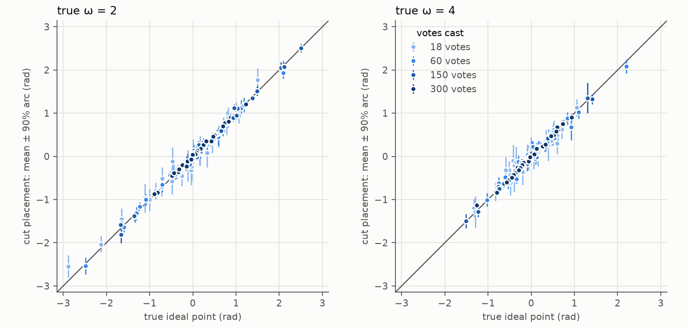
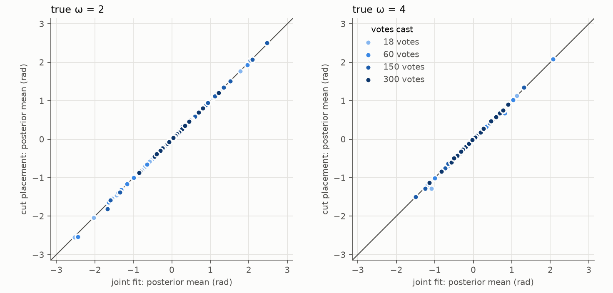
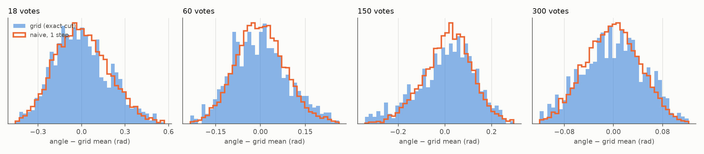

# Placing low-vote legislators with a cut posterior: method and simulation check

*2026-10-25. Tables and figures from `scripts/cut_posterior_report.py`.*

## 1. Problem

Following the paper, legislators who miss more than 40% of a House's roll
calls are excluded from the fit. In the 100th–119th Houses this removes
4–24 members per House (typically 10–20 of ~440). They are mostly members
who served part of the term (resignations, deaths, special elections) plus
the Speaker, who by custom rarely votes. In the 116th House, for example,
Nancy Pelosi (missing 91% of roll calls), Elijah Cummings, Chris Collins and
Kweisi Mfume are all excluded.

For a public website these members should still be shown, with honest
uncertainty, without changing the fit of everyone else (and so without
changing the chamber-level results χ₀, χ_D, χ_R and WAIC reported in the
paper).

## 2. Method

Write θ = (ψ, ζ, κ, ω) for the roll-call parameters and the prior
concentration, β for the fitted members' ideal points, y_fit for their votes
and y_k for the votes of excluded member k. The fit gives draws
(θ⁽ˢ⁾, β⁽ˢ⁾) ~ p(θ, β | y_fit). For each draw s we sample

  β_k⁽ˢ⁾ ~ p(β_k | θ⁽ˢ⁾, y_k) ∝ ∏_{j observed} G_κj(y_kj · e_kj(β_k)) · exp(ω cos(β_k − μ)),

so that (θ⁽ˢ⁾, β_k⁽ˢ⁾) are draws from

  p_cut(θ, β_k) = p(θ | y_fit) · p(β_k | θ, y_k).

This is the **cut distribution** (also called modular inference). Compared
with the full posterior p(θ, β_k | y_fit, y_k), the only difference is that
member k's votes are not allowed to update θ: information flows from the
roll calls to the member but not back. Because each roll call's parameters are
estimated from ~430 other votes, a member with a few dozen to a few hundred
votes would move them very little; the simulation below measures how
little.

**Is this a mainstream method?** It is established but specialised. The
"cut" was introduced as a modelling device in WinBUGS/OpenBUGS (Lunn et al.
2009) for pharmacokinetic/pharmacodynamic models, where one wants a
well-understood module (e.g. drug concentrations) to inform a second module
without the second, less trusted, module feeding back. Plummer (2015) gave
its theory and showed that the obvious MCMC implementation is wrong (below).
Jacob, Murray, Holmes and Robert (2017) discuss when it is preferable to the
full posterior (mainly when one module may be misspecified), Carmona and
Nicholls (2020) interpolate between cut and full posteriors ("semi-modular
inference"), and Pompe and Jacob (2021) study its asymptotics. Relevant here:
Pompe and Jacob find that credible regions of cut distributions can lack
nominal frequentist coverage, so the simulation below checks coverage
directly. Our use is the simplest case: one module (the fitted House) is
estimated as in the paper, and new units are scored against it, much as
fixed item parameters are used to score new respondents in item response
theory.

### 2.1 The pitfall, and why the grid sampler avoids it

The naive way to sample a cut distribution is an MCMC chain that alternates
(i) picking a draw θ⁽ˢ⁾ and (ii) taking one MCMC step for β_k given θ⁽ˢ⁾.
Plummer (2015) shows that the algorithm OpenBUGS uses for a cut does not
converge to a well-defined limiting distribution (it depends on the update
method), and in general not to p_cut: each step only moves β_k part of the way towards p(β_k | θ⁽ˢ⁾, y_k)
before θ changes again, and the stationary distribution of the alternation
is not the average of the conditionals. The bias disappears only if many
inner steps are taken for every θ⁽ˢ⁾.

Here β_k is a single angle, so no inner MCMC is needed at all. For every
draw s, `circfactor/placement.py` evaluates the unnormalised conditional
density on a grid of 4096 cells over the circle and draws a cell exactly,
then a uniform position within it. Each β_k⁽ˢ⁾ is therefore an exact draw
from p(β_k | θ⁽ˢ⁾, y_k), up to treating the density as constant within cells
of width 0.0015 rad. In the simulation below the placed members' posterior
standard deviations are 0.03–0.23 rad, at least 20 times the cell width.

The roll-call parameters are kept for 1000 evenly spaced posterior draws
(`--bill-draws`), so each House yields 1000 draws per placed member.

### 2.2 Unit tests of the sampler (`tests/test_placement.py`)

With θ held fixed at one value:

* **No votes:** the draws must follow the prior vonMises(μ, ω). Kolmogorov–
  Smirnov tests pass for ω = 0, 2 and 50.
* **5, 30 and 200 votes:** the draws are compared, by a Kolmogorov–Smirnov
  test, with the exact conditional CDF computed independently with
  `scipy.special.betainc` on a 200,000-point grid (the link function
  G_κ(u) = I_s(κ, κ), s = (π² + u)/(2π²), paper eq. 5). All pass, in float32
  and float64.

### 2.3 Why an MCMC reference failed, and what it says about the circle

An earlier version of this test used, as the reference, 5000 independent
GHMC chains (the kernel validated in `tests/test_ghmc_vonmises.py`) started
uniformly on the circle and run for 400 iterations. It passed with 5 and 200
votes and failed with 30. The exact density, computed with `betainc` on a
20,000-point grid, shows why (θ fixed, ω = 3, true β = 0.8):

| votes | local maxima | highest spurious peak (log density below the top) | escape barriers of spurious peaks | GHMC chains ending outside the main peak | grid draws outside |
|---|---|---|---|---|---|
| 5 | 1 | none | none | 0% | 0% |
| 30 | 10 | −152 | median 30, up to 65 nats | **21%** | 0% |
| 200 | 27 | −717 | median 13, up to 84 nats | 0% | 0% |

("Escape barrier": how far the log density drops from a spurious peak to
the lower of its two neighbouring minima.) Scripts: `scripts/placement_traps_modes.py`
(peaks, masses, where chains end) and `scripts/placement_traps_barriers.py`
(barriers, slopes). With 30 votes, the spurious peaks
together carry about 10⁻⁶⁷ of the mass, yet 21% of the GHMC chains ended in
them, roughly the share that started in their basins (49%) minus those that
escaped early. So the reference distribution was wrong, not the grid
sampler: the grid evaluates the density everywhere and puts essentially no
draws there, as it should.

**Why the circle has spurious peaks.** In the one-dimensional Euclidean
probit model, each vote's log-likelihood, log Φ(±(a_j β − b_j)), is concave
in β, so the conditional for β is unimodal for any number of votes. On the
circle, each vote's log-likelihood is a periodic function of β: it is high
on the arc nearer the option the member chose and low on the far arc, with
two transitions, the cutting point between ψ_j and ζ_j and its antipode. A
periodic function cannot be concave, and a product of many of them has a
local peak wherever the member agrees with "most but not all" votes. More
votes push these peaks far below the main peak (−152 at 30 votes, −717 at
200), so they carry no mass, but they do not disappear.

**Why 5 and 200 votes passed.** With 5 votes the ω = 3 prior dominates and
the density has a single peak, so there is nothing to get stuck in. With 200
votes the traps exist, but the log density away from the main peak is very
steep (median slope ~930 nats/rad, against ~225 at 30 votes). With leapfrog
step sizes up to 0.05, one momentum kick then moves a chain by about
ε²·|∇|/2 ≈ 1.2 rad, larger than the traps (0.05–0.6 rad wide), and any
proposal landing near the main peak, hundreds of nats higher, is accepted.
At 30 votes the same jump is ~0.3 rad, smaller than the deepest traps (0.4–0.8
rad wide, 25–65 nats deep), and a chain inside one essentially never leaves.
So the 200-vote pass came from the steepness, not from the absence of traps,
and a GHMC reference cannot be relied on for low-vote members.

**Implications.** (i) Placement should not use an inner MCMC chain for
low-vote members; the grid sampler is immune because it does not move
through the circle. (ii) The same spurious peaks exist in every
legislator's full conditional within the main sampler. Full-record members
(hundreds of votes) behave like the 200-vote case, and chains start in their
party's half of the circle. Whether members with many missing votes get
stuck in the main fit (Rooney, 25% missing, has the worst R-hat on the 116th
House) is worth checking, but has not been tested.

## 3. Simulation design

Script: `scripts/cut_posterior_simulation.py`. Each cell simulates one House
from the circular factor model:

* I = 200 full-record legislators (3% of votes missing at random, as in the
  House) and K = 40 low-vote legislators, J = 600 roll calls.
* Ideal points β ~ vonMises(0, ω) with **ω = 2** (χ₀ ≈ 0.30, matching the
  116th House fit, posterior mean ω = 2.02) and **ω = 4** (a more Euclidean
  configuration, as in the earlier Houses); ψ_j, ζ_j ~ Uniform(circle);
  κ_j ~ Gamma(shape 2, rate 0.05).
* The 40 low-vote members keep 3%, 10%, 25% or 50% of their votes (10
  members each): **18, 60, 150 or 300 votes**, missing at random. (Pelosi
  cast 84 votes in the 116th House; partial-term members typically
  100–550.)
* Three seeds per ω.

For each cell, three procedures:

1. **cut:** fit the 200 full-record members (20,000 burn-in, then 10,000
   iterations thinned to 1000 draws), then place the 40 with the grid
   sampler.
2. **joint:** fit all 240 together with the same settings. This is the
   full posterior, and what a looser missing-vote cutoff would do.
3. **naive cut** (seed 1 only): the naive algorithm of §2.1 with a
   random-walk Metropolis step whose proposal sd equals each member's cut
   posterior sd (well tuned), 1 or 10 inner steps per θ draw, 20,000
   iterations.

The likelihood only sees angle differences, so each posterior draw is
rotated (and the fit reflected, if needed) to best match the true
ideal points of the 200 full-record members before comparing with the
truth; the same rotation is applied to the placed members of that draw.
Ranks of low-vote members are their position among the 200 full-record
members.

## 4. Results

Six simulated Houses (ω = 2 and 4, three seeds each), 40 low-vote members
per House: 30 members per (ω, votes cast) cell, 240 in all. Coverage is of
central 90% credible arcs (nominal 0.90); with 30 members a cell's coverage
has a standard error of about 0.055.

### 4.1 Recovery of the true ideal points

| ω | votes cast | coverage, cut | coverage, joint | mean abs. error, cut (rad) | mean abs. error, joint (rad) | 90% width, cut (rad) | 90% width, joint (rad) | rank coverage, cut | rank coverage, joint |
|---|---|---|---|---|---|---|---|---|---|
| 2 | 18 | 0.90 | 0.90 | 0.130 | 0.134 | 0.52 | 0.52 | 0.97 | 0.97 |
| 2 | 60 | 0.93 | 0.97 | 0.056 | 0.052 | 0.27 | 0.27 | 0.97 | 0.97 |
| 2 | 150 | 0.87 | 0.90 | 0.050 | 0.044 | 0.18 | 0.17 | 0.97 | 0.97 |
| 2 | 300 | 0.93 | 0.93 | 0.029 | 0.029 | 0.12 | 0.12 | 0.90 | 0.97 |
| 4 | 18 | 0.97 | 0.97 | 0.114 | 0.121 | 0.48 | 0.49 | 0.90 | 0.90 |
| 4 | 60 | 0.77 | 0.77 | 0.088 | 0.086 | 0.29 | 0.28 | 0.73 | 0.77 |
| 4 | 150 | 0.93 | 0.93 | 0.037 | 0.036 | 0.20 | 0.18 | 0.93 | 0.93 |
| 4 | 300 | 0.93 | 0.90 | 0.032 | 0.031 | 0.12 | 0.12 | 0.93 | 0.97 |
| **all** | | **0.904** | **0.908** | | | | | | |

Overall coverage of the cut placement is 0.908 (ω = 2) and 0.900 (ω = 4),
against 0.925 and 0.892 for the joint fit. The one low cell (ω = 4, 60
votes, 0.77) comes from two seeds with 7 of 10 members covered, and the
joint fit has exactly the same coverage there, so it is not specific to the
cut; a cell this low has probability ~0.03 by chance, ~0.2 for at least one
of 8 cells. Intervals widen as votes fall (90% width 0.12 rad with 300 votes,
0.5 rad with 18), which is the honest uncertainty the website should show.



### 4.2 Cut placement vs the full (joint) posterior

| ω | votes cast | median \|mean difference\| / joint sd | max | median width ratio cut / joint |
|---|---|---|---|---|
| 2 | 18 | 0.07 | 0.22 | 1.00 |
| 2 | 60 | 0.09 | 1.06 | 1.00 |
| 2 | 150 | 0.19 | 2.33 | 1.00 |
| 2 | 300 | 0.10 | 0.54 | 1.01 |
| 4 | 18 | 0.07 | 1.10 | 0.98 |
| 4 | 60 | 0.07 | 1.32 | 0.99 |
| 4 | 150 | 0.14 | 0.75 | 1.02 |
| 4 | 300 | 0.21 | 0.91 | 1.00 |

The two posteriors agree closely: the typical difference of posterior means
is a tenth to a fifth of a posterior sd, and interval widths match to within
2%. Part of the difference is Monte Carlo noise, since the joint fit is a
separate MCMC run.



### 4.3 Effect on everyone else

Including the 40 low-vote members in the fit (joint) rather than placing them
afterwards (cut) moves the 200 full-record members' posterior means by a
median of 0.08–0.33 posterior sd (max 0.89 sd) per House, again partly Monte
Carlo noise between two runs. Circularity of the full-record members is
unchanged: χ₀ = 0.287 / 0.290 (cut / joint, truth 0.292), 0.353 / 0.353
(0.354), 0.314 / 0.311 (0.315) for ω = 2, and 0.122 / 0.121 (0.125),
0.157 / 0.155 (0.155), 0.118 / 0.122 (0.118) for ω = 4.

### 4.4 The naive cut algorithm

Compared in the fit's own frame with the grid draws (the exact cut), median
over the 10 members of each cell, seed 1:

| ω | votes cast | sd ratio, naive 1 step | (min) | sd ratio, naive 10 steps | (min) | mean shift / sd, 1 step |
|---|---|---|---|---|---|---|
| 2 | 18 | 0.97 | 0.93 | 1.00 | 0.96 | 0.02 |
| 2 | 60 | 0.93 | 0.87 | 0.99 | 0.97 | 0.02 |
| 2 | 150 | 0.90 | 0.81 | 0.98 | 0.97 | 0.02 |
| 2 | 300 | 0.88 | 0.86 | 0.99 | 0.98 | 0.03 |
| 4 | 18 | 0.99 | 0.95 | 1.00 | 0.98 | 0.04 |
| 4 | 60 | 0.96 | 0.92 | 1.01 | 0.95 | 0.02 |
| 4 | 150 | 0.93 | 0.88 | 1.00 | 0.97 | 0.03 |
| 4 | 300 | 0.91 | 0.87 | 0.98 | 0.96 | 0.02 |

With one Metropolis step per θ draw, the naive algorithm centres correctly
but is too narrow: its sd is 88–99% of the correct value (down to 81% for
single members), worse for members with more votes, whose conditional moves
more with θ relative to its own width. With 10 inner steps the error is
within ~2%. This is Plummer's (2015) point in miniature: the naive chain
cannot follow how p(β_k | θ) shifts from one θ draw to the next, and so
misses part of the variance Var_θ(E[β_k | θ]).



*(An earlier version of this comparison used the grid draws after aligning
each draw to the truth, which removes the configuration's slow common
rotation, and the naive draws without it; that made the naive chain look too
wide. Both are now compared in the fit's own frame.)*

## 5. Findings

1. **The cut placement recovers the true ideal points with nominal coverage**
   (0.90–0.91 overall for 90% intervals) from 18 to 300 votes, in both a
   circular (ω = 2) and a more Euclidean (ω = 4) House. Pompe and Jacob's
   warning that cut intervals can under-cover does not show up here: cut and
   full-posterior coverage are the same.
2. **It is practically the same as the full posterior** for members with
   ≤ 50% of the votes: means within ~0.1–0.2 sd, widths within 2%.
3. **It leaves everyone else's results unchanged by construction**, and in the
   simulation including the low-vote members instead would hardly have
   changed them either (χ₀ within 0.004).
4. **The naive cut algorithm would understate uncertainty** by up to ~12% in
   sd (~19% for single members) with one inner step; the grid sampler has no
   such bias, and 10 inner steps nearly remove it.
5. **No sign of MCMC chains trapped in spurious peaks in the joint fit.** The
   joint fit samples the 18- and 60-vote members with the main MCMC, yet its
   coverage and errors match the grid placement there (largest disagreement
   1.1 and 1.3 sd), and none of the 120 such members sits far from its grid
   placement. In the main sampler a member's chain starts near the centre of
   the circle (here uniform on (−π/2, π/2)) and the prior and full-record
   members keep it near the main peak, whereas the spurious peaks of
   section 2.3 lie far around the circle. Trapping is therefore a hazard for
   samplers started anywhere on the circle (as in the unit-test reference),
   not something seen in the fit. It stays worth checking on the real Houses
   (e.g. Rooney in the 116th).

## 6. Caveats for the real data

* **Missing at random.** The model treats missing votes as missing at random.
  For partial-term members this is reasonable (they were not in office). The
  Speaker is different: she votes mainly on high-stakes, party-line roll
  calls, so her placement reflects those votes only, and the website should
  say so.
* **Agenda over time.** In the simulation roll calls are exchangeable, so a
  member who served only the first months is equivalent to one with
  randomly missing votes. In a real House the agenda changes over the term,
  so a partial-term member's votes are a non-random subset of roll calls.
  The cut placement still conditions correctly on the roll calls they did
  vote on; their intervals just reflect how informative those were.
* **Members with very few votes** (< 25 by default, `--place-min-votes`) are
  not placed: their posterior is close to the prior.

## 7. Reproducing

```bash
cd python
uv run pytest tests/test_placement.py                  # sampler tests (~2 min)
for w in 2 4; do for s in 1 2 3; do
  uv run python scripts/cut_posterior_simulation.py --omega $w --seed $s \
      --burnin 20000 --samples 1000 --thin 10 $([ $s = 1 ] && echo --naive)
done; done                                             # ~4.5 h on an RTX 5070 Ti
uv run python scripts/cut_posterior_report.py          # tables + docs/figures/
```

## References

* Carmona, C. U. and Nicholls, G. K. (2020). Semi-modular inference:
  enhanced learning in multi-modular models by tempering the influence of
  components. *Proceedings of AISTATS 2020*, PMLR 108, 4226–4235.
  arXiv:2003.06804.
* Jacob, P. E., Murray, L. M., Holmes, C. C. and Robert, C. P. (2017). Better
  together? Statistical learning in models made of modules. arXiv:1708.08719.
* Lunn, D., Best, N., Spiegelhalter, D., Graham, G. and Neuenschwander, B.
  (2009). Combining MCMC with 'sequential' PKPD modelling. *Journal of
  Pharmacokinetics and Pharmacodynamics* 36(1), 19–38.
  doi:10.1007/s10928-008-9109-1.
* Plummer, M. (2015). Cuts in Bayesian graphical models. *Statistics and
  Computing* 25(1), 37–43. doi:10.1007/s11222-014-9503-z.
* Pompe, E. and Jacob, P. E. (2021). Asymptotics of cut distributions and
  robust modular inference using Posterior Bootstrap. arXiv:2110.11149
  (later versions add M. J. Kasprzak as a co-author).
* Yu, X. and Rodríguez, A. (2021). Spatial voting models in circular spaces:
  A case study of the U.S. House of Representatives. *Annals of Applied
  Statistics* 15(4), 1897–1922.
